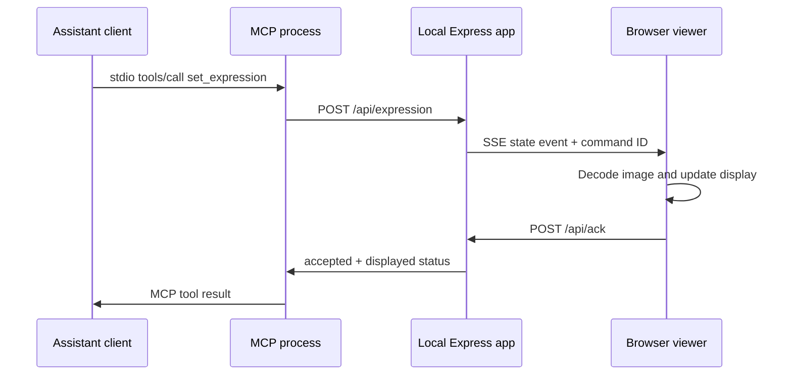

# Request path

This describes the completed behavior participants are building. On a fresh main checkout, only list_expressions is implemented. The HTTP server, browser viewer, and stdio bootstrap are supplied; client configuration and set/reset registrations are exercises.

MCP uses stdio. Browser SSE is a separate application connection, not the MCP transport. Express serves the Vite production build and the image assets from one origin. The manifest in `assets/expressions/manifest.json` is the source of truth for IDs, labels, descriptions, and filenames.

`list_expressions` reads the manifest without requiring the HTTP server. `set_expression` validates its `name` through the SDK schema, then the HTTP server validates again. `reset_expression` requests neutral. Runtime failures produce `isError: true` MCP results; stdout is reserved for protocol messages.

## Acceptance versus display

Every accepted command gets a unique ID. Each SSE connection gets a viewer ID. The browser decodes the asset, updates the image, waits for a paint opportunity, and acknowledges that command. This is application-level evidence, not proof that a human saw the screen or that a background tab was visible.

| Status | Meaning |
| --- | --- |
| `displayed` | At least one connected viewer acknowledged the current image within 1.5 seconds. |
| `accepted_no_viewer` | State changed, but no browser was connected. Open the viewer. |
| `accepted_unconfirmed` | Browser connected, but no valid acknowledgement arrived within 1.5 seconds. Check asset loading or background tabs. |

Late acknowledgements can update `/api/state`, but do not rewrite an already returned tool result. New commands supersede older ones. Only the latest command can be acknowledged. Refresh or SSE reconnect immediately receives current state. Logs are per-browser and bounded; server restarts reset state to neutral.

The server binds to loopback, rejects unexpected Host headers and cross-origin requests, limits JSON bodies, and exposes no file writes or shell execution. It is a local teaching app, not a multi-user hosted service.
